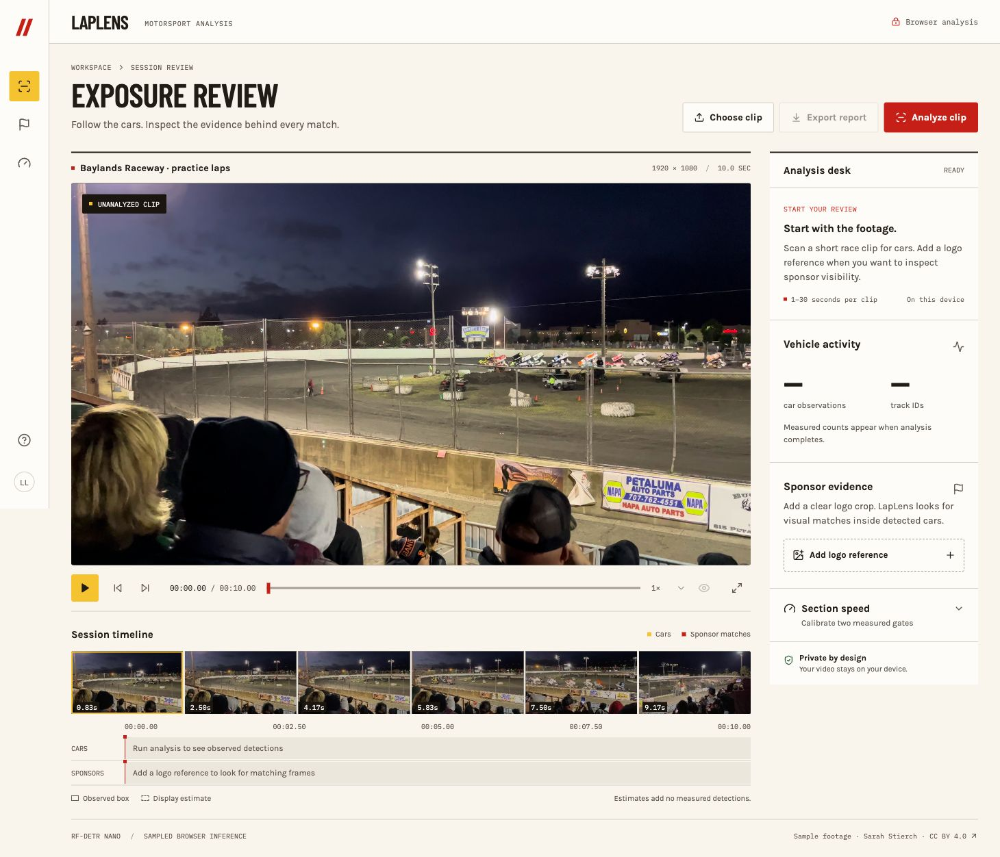

# LapLens

Review racing footage with car detection, sponsor-reference matching, and calibrated section-speed estimates. Analysis runs in your browser. Your video stays on your device.



## Use

1. Load the sample or choose a browser-supported MP4 or WebM: 1–30 seconds, up to 250 MB.
2. Optionally add a clear, tightly cropped sponsor logo.
3. Analyze the clip, inspect observations on the timeline, and export the run as JSON.
4. For section speed, use a stationary-camera shot, enter the measured distance between two gates, and place the gates across the track.

The first run downloads the model. Runtime depends on your browser and hardware. WebGPU is preferred; WebAssembly is the fallback. No inference server is required.

## How it works

- **Detection:** quantized RF-DETR Nano identifies COCO `car` objects in a dedicated worker. Clips up to 12 seconds are sampled at 3 Hz; longer clips at 1 Hz.
- **Tracking:** overlap and center distance associate detections across sampled frames. Solid boxes show observations. Dashed boxes estimate positions between nearby observations and may bridge changed track IDs.
- **Sponsor matching:** OpenCV ORB features and a RANSAC homography compare the supplied reference against detected car crops. OpenCV loads only when a reference is supplied.
- **Section speed:** measured gate distance divided by interpolated crossing time for one associated track. Results require a fixed-camera confirmation and a supplied distance.
- **Playback:** overlays follow the video's current time. A separate decoder generates timeline thumbnails.

## Measurement limits

Car observations are frame detections, not verified unique vehicles. Track IDs can fragment or switch during occlusion, camera motion, and cuts. Estimated playback boxes add no measured evidence.

Sponsor matches indicate visual-feature agreement with a supplied reference. They are not OCR, verified brand identity, or a broadcast-exposure rating. Exposure windows connect nearby sampled matches; intervening frames are not independently measured.

Section speed is an approximate average, not instantaneous speed. Camera movement, incorrect gate distance, missed detections, or track switches can invalidate it. There are no validated accuracy or speed-error claims. This demo needs ground-truth evaluation before operational use.

## Develop

Requires Node.js 22–24 and pnpm 9.

```sh
pnpm install
pnpm dev
```

Open http://localhost:3210.

```sh
pnpm lint
pnpm typecheck
pnpm build:space
pnpm preview:space
```

`src/components` contains the workspace and filmstrip. `src/lib` contains the analyzer, vision worker, and shared types. `src/app` contains the page, layout, and stylesheet. `public` holds the sample footage, model, and generated runtime assets.

## Deploy

`pnpm build:space` produces `out/`, including this project card and the required notices. After authenticating the Hugging Face CLI:

```sh
hf upload <account>/laplens out . --repo-type space
```

Use a Static Space. Other static hosts must support video byte ranges and serve the worker and model assets from the same origin. The sample video uses anonymous CORS for CDN redirects. `pnpm build` produces a standalone Next.js build for Node hosting.

## License

Application code is MIT licensed. Models, libraries, fonts, and footage retain their own licenses. See [THIRD_PARTY_NOTICES.md](THIRD_PARTY_NOTICES.md). The sample is an adapted excerpt of Sarah Stierch's CC BY 4.0 raceway video; retain its attribution when redistributing it.
